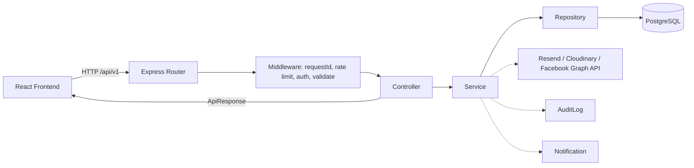

# Tài liệu Kiến trúc Hệ thống — Marka

> **Phạm vi:** tài liệu mô tả đúng code đang chạy trong `backend/src`, `frontend/src` và `backend/prisma/schema.prisma`.
> Các phần chưa triển khai được liệt kê riêng ở mục 10 (Roadmap), không mô tả như tính năng đã có.

---

## 1. Tổng quan

Marka là ứng dụng web quản lý nội dung mạng xã hội theo workspace:

| Thành phần | Công nghệ | Vị trí |
| :--- | :--- | :--- |
| API | Node.js + TypeScript (ESM), Express 4 | `backend/src` |
| ORM / DB | Prisma 5 + PostgreSQL | `backend/prisma` |
| Cache / Queue | Redis (ioredis) + BullMQ | `backend/src/config/redis.ts`, `backend/src/workers` |
| Frontend | React 19 + Vite + TypeScript | `frontend/src` |
| UI | Tailwind CSS v4, React Router, React Query, Zustand, react-hook-form + Zod | `frontend/src` |
| Email | Resend | `backend/src/utils/mailer.client.ts` |
| Lưu ảnh | Cloudinary | `backend/src/utils/cloudinary.client.ts` |
| Facebook | Facebook Graph API v21.0 (OAuth) | `backend/src/modules/channel/facebook.client.ts` |

Luồng request một chiều:



---

## 2. Cấu trúc backend

```
backend/src/
  app.ts                  # khởi tạo Express, middleware toàn cục, mount /api/v1
  server.ts               # listen + graceful shutdown + bật worker nếu ENABLE_WORKERS
  worker-server.ts        # entry point chạy worker riêng (npm run worker)
  config/                 # env (Zod), prisma client + extension, redis
  middlewares/            # auth, validate, error, rateLimiter, upload, requestId, enforceHttps
  modules/<feature>/
    <feature>.validation.ts
    <feature>.controller.ts
    <feature>.service.ts
    <feature>.repository.ts
    index.ts
  routes/index.ts         # toàn bộ endpoint /api/v1
  templates/              # HTML email
  utils/                  # ApiResponse, errors, jwt, cookies, password, encryption, mailer, cloudinary, logger
  workers/                # queue BullMQ + worker
```

Các module hiện có: `auth`, `user`, `workspace`, `brandvoice`, `channel`, `post`, `audit`, `health`.

### 2.1. Router & Middleware

`app.ts` gắn theo thứ tự:

1. `enforceHttps` (chỉ production).
2. `helmet`, `cors({ origin: env.CLIENT_URL, credentials: true })`, `compression`.
3. `cookieParser`, `express.json`, `express.urlencoded`.
4. `requestId` — lấy `x-request-id` hoặc sinh UUID, trả lại header `X-Request-Id`.
5. `morgan` + `winston` (bỏ qua ở `NODE_ENV=test`).
6. `apiLimiter` cho toàn bộ `/api/`.
7. Swagger UI tại `/api-docs` (chỉ non-production).
8. `v1Routes` tại `/api/v1`.
9. Fallback `NotFoundError`, cuối cùng là `errorHandler`.

Middleware nghiệp vụ trong `middlewares/`:

| Middleware | Hàm | Việc làm |
| :--- | :--- | :--- |
| `auth.ts` | `requireAuth` | Đọc `Authorization: Bearer`, verify JWT, nạp user từ DB, kiểm tra `isSuspended` và `tokenVersion` |
| | `optionalAuth` | Như trên nhưng token sai thì bỏ qua, coi như khách |
| | `requireRoles(...roles)` | Kiểm tra `User.systemRole` |
| | `requireWorkspaceRole(...roles)` | Lấy `workspaceId` từ `x-workspace-id`, params, query hoặc body; chặn lệch header/URL; kiểm tra `WorkspaceMember`; `SYSTEM_ADMIN` được coi là `OWNER` |
| `validate.ts` | `validate({ body, params, query })` | Parse bằng Zod, ghi đè `req.*` bằng dữ liệu đã chuẩn hoá |
| `rateLimiter.ts` | `apiLimiter` | 200 request/phút/IP cho `/api/` |
| | `authLimiter` | 15 request/15 phút cho `POST /auth/register` và `POST /auth/google` |
| | `loginLimiter` | 5 lần **thất bại**/15 phút theo `IP:email` |
| | `createWorkspaceLimiter` / `aiLimiter` | Hàm khung theo workspace (chưa gắn route AI) |
| `upload.ts` | `uploadPostMedia` | Multer memory, chỉ JPG/PNG/WEBP, media ≤ 10MB |
| `error.ts` | `errorHandler` | Chuẩn hoá lỗi (mục 3) |
| `requestId.ts` | `requestId` | Sinh/truyền `req.id` |
| `enforceHttps.ts` | `enforceHttps` | Redirect 301 sang HTTPS ở production |

### 2.2. Controller

- Mỗi hàm được bọc `catchAsync` và trả `ApiResponse`.
- Controller chỉ bóc `req.params`, `req.body`, `req.query`, `req.user`, `req.file` rồi gọi service.
- Không gọi Prisma, không chứa logic nghiệp vụ.

### 2.3. Service

- Chứa toàn bộ nghiệp vụ: kiểm tra quyền, trạng thái, transaction, gọi client ngoài.
- Ném lỗi bằng `AppError` và các lớp con (`NotFoundError`, `ConflictError`, `ForbiddenError`, `UnauthorizedError`, `BadRequestError`).
- Ghi audit log qua `auditService.recordAuditLog` (lỗi ghi audit chỉ log cảnh báo, không làm hỏng request).
- Không truy cập `req`/`res`.

### 2.4. Repository

- Chỉ chứa truy vấn Prisma; mỗi module có repository riêng (trừ `auth` dùng chung `userRepository`).
- Tên hàm theo hành động: `findUserByEmail`, `createWorkspaceWithOwner`, `transitionPostStatus`...
- Một số thao tác atomic tự mở transaction: `createUserWithDefaultWorkspace`, `createWorkspaceWithOwner`, `acceptInviteAsMember`, `upsertFacebookChannels`, `deleteChannelAndCancelSchedules`.

---

## 3. Định dạng phản hồi & xử lý lỗi

Mọi response đi qua `utils/ApiResponse.ts`:

```json
{
  "status": "success",
  "message": "Lấy danh sách bài viết thành công",
  "data": { "posts": [] },
  "meta": { "page": 1, "limit": 10, "total": 0, "totalPages": 0 }
}
```

Lỗi:

```json
{
  "status": "fail",
  "message": "Dữ liệu không hợp lệ",
  "errors": [{ "field": "email", "message": "Email không hợp lệ" }]
}
```

`status` là `success`, `fail` (4xx) hoặc `error` (5xx). `data`/`meta` chỉ có khi khác `null`.

`middlewares/error.ts` xử lý theo thứ tự:

1. `AppError` → giữ `statusCode`, `message`, `errors`.
2. `ZodError` → 422, `errors` dạng `{ field, message }`.
3. Prisma `P2002` → 409; `P2025` → 404.
4. Còn lại → 500 `"Đã có lỗi hệ thống xảy ra"`; chỉ trả `errors.debug` khi `NODE_ENV=development`.

---

## 4. Xác thực & phiên làm việc

- **Access token**: JWT ký bằng `JWT_ACCESS_SECRET`, hạn mặc định `15m`, chứa `{ id, email, systemRole, tokenVersion }`.
- **Refresh token**: JWT ký bằng `JWT_REFRESH_SECRET`, hạn mặc định `7d`, chứa `{ id, tokenVersion }`, lưu trong cookie `refreshToken` (`HttpOnly`, `SameSite=Lax` ở dev / `None` + `Secure` ở production, `maxAge` 7 ngày).
- **Không có bảng refresh token.** Thu hồi phiên bằng cách tăng `User.tokenVersion`: logout, đổi mật khẩu, hoặc khi token cũ được dùng lại.
- `POST /auth/refresh-token` nhận token từ cookie hoặc body, đối chiếu `tokenVersion` với DB rồi cấp cặp token mới.
- **Google OAuth**: frontend gửi `idToken` lên `POST /auth/google`; backend verify với `google-auth-library`, chỉ chấp nhận email đã xác minh, tìm user theo email hoặc tạo mới, liên kết `googleId` nếu tài khoản local chưa có.
- Đăng ký local tạo luôn **workspace mặc định** với user là `OWNER` trong cùng transaction.
- Mật khẩu hash bằng bcrypt (10 salt rounds).

---

## 5. Đa tenant (workspace)

- Mọi dữ liệu nghiệp vụ gắn `workspaceId`.
- `requireWorkspaceRole` lấy `workspaceId` theo thứ tự: header `x-workspace-id` → `req.params.workspaceId` → `req.query.workspaceId` → `req.body.workspaceId`.
- Nếu header và URL khác nhau → 403 (`Workspace ID không khớp giữa header và URL`).
- `SYSTEM_ADMIN` được xử lý như `OWNER` ở mọi workspace.
- Vai trò workspace: `OWNER`, `CONTENT_CREATOR`.
- Quy tắc nghiệp vụ đang áp dụng:
  - Sửa/xoá workspace, mời thành viên, đổi vai trò, xoá thành viên, Brand Voice, kênh, duyệt bài: `OWNER`.
  - Xem thành viên, bài viết, Brand Voice, kênh; tạo/sửa/xoá bài của mình; gửi duyệt: mọi thành viên.
  - `CONTENT_CREATOR` chỉ sửa/xoá bài do mình tạo (`Post.createdById`).
  - Không thể rời/xoá/hạ vai trò **Owner cuối cùng** của workspace.

---

## 6. Transaction & xoá mềm

### 6.1. Transaction

- Service sở hữu transaction cho luồng nhiều bước; repository nhận `tx` khi cần.
- Repository được tự mở transaction cho thao tác atomic tự chứa.
- Các chỗ đang dùng `prisma.$transaction`:
  - `userRepository.createUserWithDefaultWorkspace` — tạo User + Workspace + WorkspaceMember.
  - `workspaceRepository.createWorkspaceWithOwner` — tạo Workspace + Owner.
  - `workspaceRepository.acceptInviteAsMember` — đánh dấu invite đã dùng + tạo member.
  - `workspaceRepository.softDeleteWorkspace` — chuyển kênh sang `EXPIRED` + xoá mềm workspace.
  - `channelRepository.upsertFacebookChannels` — upsert nhiều Page.
  - `channelRepository.deleteChannelAndCancelSchedules` — huỷ lịch + xoá kênh.
  - `postRepository.listPostsAndCount` — `findMany` + `count`.
- `utils/transaction.ts` có helper `withTransaction(action, { maxWait, timeout })` nhưng hiện chưa module nào dùng.

### 6.2. Xoá mềm

`config/prismaExtensions.ts` thêm `deletedAt: null` cho mọi thao tác đọc (`findFirst`, `findFirstOrThrow`, `findMany`, `findUnique`, `findUniqueOrThrow`, `count`, `aggregate`, `groupBy`) trên 4 model:

- `Workspace`
- `Post`
- `CreditPackage`
- `MediaAsset`

Bản ghi đã xoá chỉ đọc được bằng `basePrisma` (export từ `config/db.ts`). API hiện chưa có endpoint khôi phục.

---

## 7. Tác vụ nền (BullMQ)

- `config/redis.ts` tạo 2 kết nối ioredis: `queueConnection` (cho BullMQ) và `cacheConnection` (health check + OAuth state/session).
- `workers/queues.ts` tạo 3 queue với `defaultJobOptions`: `attempts: 3`, backoff exponential 2s, giữ job completed 1 giờ / failed 24 giờ:

| Queue | Tên |
| :--- | :--- |
| content generation | `content-generation-queue` |
| publishing | `publishing-queue` |
| email | `email-queue` |

- `workers/queue-manager.ts` cung cấp `enqueue`, `getJobStatus`, `cancelJob`, `retryJob`, `pauseQueue`, `resumeQueue`, `getQueueStats`, `closeQueues`.
- `workers/index.ts` tạo `contentWorker`, `publishingWorker`, `emailWorker`; processor hiện chỉ log, `updateProgress(100)` và trả `{ success: true }`.
- **Chưa có module nào enqueue job**, chưa có xử lý AI/đăng bài/gửi email qua worker.
- `ENABLE_WORKERS=true` (mặc định) → `server.ts` import `workers/start.ts` và chạy worker cùng process API. Production có thể đặt `false` và chạy `npm run worker` (`worker-server.ts`) riêng.

---

## 8. Tích hợp ngoài

### 8.1. Facebook Page (OAuth)

1. `GET /channels/facebook/oauth/url?workspaceId=...` (OWNER) sinh `state` 32 byte, lưu Redis 600 giây cùng `{ userId, workspaceId }`, trả URL Facebook.
2. Người dùng đồng ý → Facebook redirect về `GET /channels/facebook/oauth/callback`.
3. Backend đổi `code` → token ngắn → long-lived token, gọi `/me/accounts` lấy Page, mã hoá Page token bằng AES-256-GCM, lưu session Redis 600 giây, redirect về `CLIENT_URL/channels?fb=select&session=...`.
4. `GET /channels/facebook/oauth/session/:sessionId` trả danh sách Page (không kèm token).
5. `POST /channels/facebook/oauth/session/:sessionId/connect` lưu các Page đã chọn vào `ChannelConnection` (upsert theo `workspaceId + FACEBOOK + externalAccountId`).
6. `DELETE /channels/:channelId` xoá kênh và chuyển các `ScheduledPost` đang `SCHEDULED` sang `CANCELLED`.

Scope xin: `pages_show_list`, `pages_read_engagement`, `pages_manage_posts`.
Biến môi trường: `FACEBOOK_APP_ID`, `FACEBOOK_APP_SECRET`, `FACEBOOK_REDIRECT_URI`.

### 8.2. Email (Resend)

- `mailerClient.sendEmail` bỏ qua và trả `true` khi `NODE_ENV=test`.
- Nếu thiếu `RESEND_API_KEY`: log cảnh báo và trả `false`.
- Template hiện có: `workspaceInviteEmail.ts`, `postReviewEmail.ts`.
- `workspaceInviteEmail` dùng trong `inviteMember`; `postReviewEmail` dùng trong `post.notification.ts` (email cho Owner khi có bài chờ duyệt, email cho tác giả khi duyệt/từ chối).
- `inviteMember` chỉ lưu lời mời sau khi gửi email thành công; nếu gửi lỗi → 502.

### 8.3. Ảnh (Cloudinary)

- Multer giữ file trong memory; service gọi `cloudinaryClient.uploadImageBuffer(buffer, folder)`.
- Nếu chưa cấu hình Cloudinary → 400 `"Chưa cấu hình Cloudinary để tải ảnh lên"`.
- Media bài viết: upload vào `marka/workspaces/:workspaceId/posts/:postId`.
- Media bài viết lưu `MediaAsset` với `type=IMAGE`, `source=UPLOADED`.

---

## 9. Audit, thông báo & quan sát

- **Audit**: `recordAuditLog` ghi `AuditLog` với `action` dạng chuỗi. Các action đang dùng: `USER_REGISTER`, `USER_LOGIN`, `USER_GOOGLE_LOGIN`, `USER_LOGOUT`, `USER_UPDATE_PROFILE`, `USER_CHANGE_PASSWORD`, `WORKSPACE_CREATE`, `WORKSPACE_UPDATE`, `WORKSPACE_DELETE`, `MEMBER_INVITED`, `MEMBER_JOINED`, `MEMBER_LEFT`, `MEMBER_REMOVED`, `MEMBER_ROLE_CHANGED`, `BRAND_VOICE_UPDATED`, `CHANNEL_CONNECTED`, `CHANNEL_DISCONNECTED`, `POST_SUBMITTED`, `POST_APPROVED`, `POST_REJECTED`.
- **Notification**: bảng `Notification` được ghi khi:
  - thành viên mới tham gia workspace (gửi cho các Owner còn lại, type `MEMBER_JOINED`);
  - bài được gửi duyệt (type `POST_SUBMITTED`, gửi các Owner);
  - bài được duyệt/từ chối (type `POST_APPROVED`/`POST_REJECTED`, gửi tác giả).
- **Email bài viết**: `post.notification.ts` gửi email cho Owner khi có bài chờ duyệt và cho tác giả khi bài được duyệt/từ chối, dùng template trong `templates/postReviewEmail.ts`.
- API hiện **chưa có endpoint đọc danh sách** thông báo.
- **Log**: Winston; development log màu + text, production log JSON; morgan ghi access log qua `morganStream`.
- **Health**: `GET /health` trả uptime, trạng thái DB (`SELECT 1`), Redis (`PING`), RSS, timestamp, version. Endpoint công khai, không yêu cầu auth.

---

## 10. Frontend

- React 19 + Vite + TypeScript, alias `@/`.
- Định tuyến: `frontend/src/router/index.tsx`, lazy-load từng trang.
- Trang đã có:
  - `/login`, `/register`, `/invites/:token`
  - `/` (dashboard), `/posts`, `/posts/new`, `/posts/:postId/edit`
  - `/channels`, `/brand-voice`
  - `/settings/appearance`, `/settings/workspace`, `/settings/members`
- Trang **placeholder** dùng `ComingSoonPage`: `/schedule`, `/ai`, `/publishing`, `/billing`.
- HTTP: `services/httpClient.ts` (axios + interceptor refresh token), mỗi feature có `services/<feature>/*.api.ts`.
- Server state: React Query; global state: Zustand (`auth`, `theme`, `ui`); form: react-hook-form + Zod.
- Env đọc qua `config/env.ts`.

---

## 11. Roadmap — phần chưa có trong code

Các mục dưới đây **chưa được triển khai**; tài liệu chi tiết tương ứng đã được gộp vào `docs/specs/README.md` (mục Roadmap) và không còn sơ đồ lớp riêng.

- AI sinh nội dung (OpenAI), Viral Score, sinh ảnh.
- Credit, CreditPackage, Order, PayOS, webhook thanh toán.
- Lịch đăng bài, publish worker thật, Calendar.
- Post Analytics, `PostMetric`, n8n.
- Admin panel, quản lý user/workspace, dashboard hệ thống.
- API Notification (đọc thông báo), WebSocket/SSE.
- Giao việc cho thành viên (UC42/UC43).
