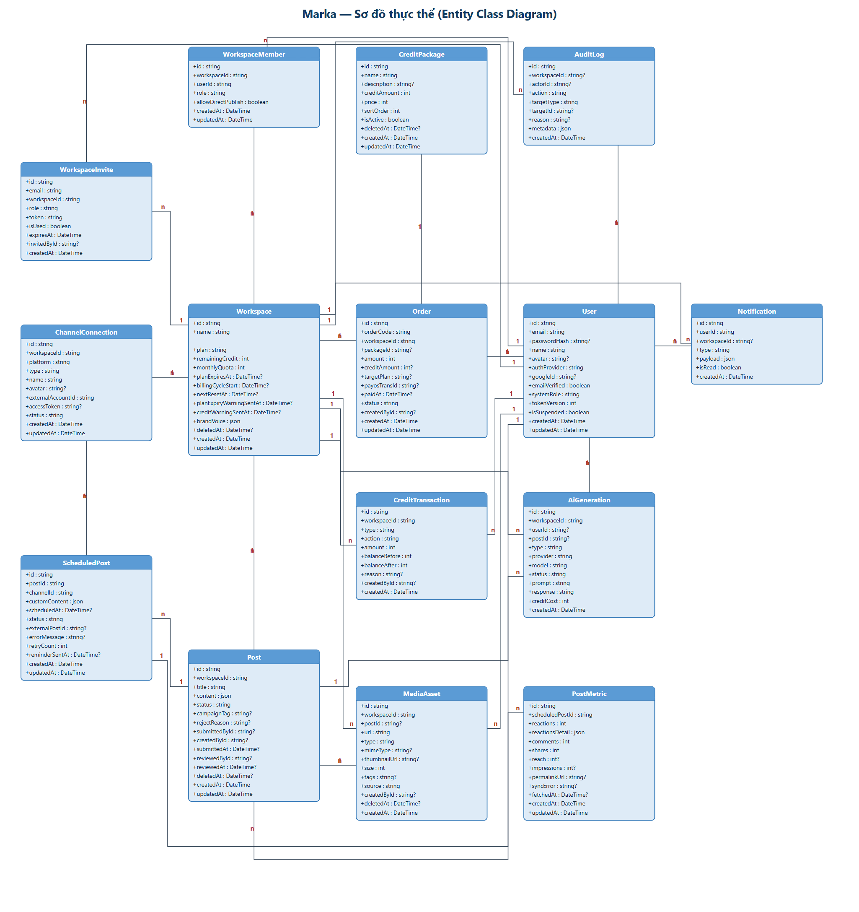

# Thiết kế Cơ sở Dữ liệu — Hệ thống Marka

> **Database:** PostgreSQL &nbsp;|&nbsp; **ORM:** Prisma &nbsp;|&nbsp; **Tổng số bảng:** 16
>
> **Trạng thái:** tài liệu mô tả đúng `backend/prisma/schema.prisma`. Schema có 16 bảng và API hiện dùng cả 16: `users`, `workspaces`, `workspace_members`, `workspace_invites`, `posts`, `tasks`, `media_assets`, `channel_connections`, `scheduled_posts`, `post_metrics`, `ai_generations`, `credit_transactions`, `credit_packages`, `orders`, `notifications`, `audit_logs`.

---

## ERD Tổng quan

---

## 1. Nhóm Auth & User

### Bảng `users`

| Tên cột | Kiểu dữ liệu | Ràng buộc | Mô tả |
|---------|-------------|-----------|-------|
| `id` | VARCHAR(36) | PK | Định danh duy nhất (UUID) |
| `email` | VARCHAR(255) | UNIQUE, NOT NULL | Địa chỉ email đăng nhập |
| `passwordHash` | VARCHAR(255) | NULL | Mật khẩu đã mã hoá (bcrypt) |
| `name` | VARCHAR(255) | NOT NULL | Tên hiển thị |
| `avatar` | VARCHAR(255) | NULL | URL ảnh đại diện |
| `authProvider` | ENUM | NOT NULL | Phương thức đăng nhập: `LOCAL`, `GOOGLE` |
| `googleId` | VARCHAR(255) | NULL | Google OAuth ID |
| `emailVerified` | BOOLEAN | DEFAULT false | Trạng thái xác thực email |
| `systemRole` | ENUM | DEFAULT USER | Vai trò hệ thống: `SYSTEM_ADMIN`, `USER` |
| `tokenVersion` | INT | DEFAULT 1 | Phiên bản token (dùng để vô hiệu hoá JWT) |
| `isSuspended` | BOOLEAN | DEFAULT false | Trạng thái bị khoá tài khoản |
| `createdAt` | DATETIME | NOT NULL | Thời điểm tạo |
| `updatedAt` | DATETIME | NOT NULL | Thời điểm cập nhật |

---

## 2. Nhóm Workspace Management

### Bảng `workspaces`

| Tên cột | Kiểu dữ liệu | Ràng buộc | Mô tả |
|---------|-------------|-----------|-------|
| `id` | VARCHAR(36) | PK | Định danh duy nhất |
| `name` | VARCHAR(255) | NOT NULL | Tên workspace |
| `plan` | ENUM | DEFAULT FREE | Gói dịch vụ: `FREE`, `PRO`, `ENTERPRISE` |
| `remainingCredit` | INT | DEFAULT 100 | Số credit còn lại |
| `monthlyQuota` | INT | DEFAULT 100 | Legacy, không dùng |
| `planExpiresAt` | DATETIME | NULL | Legacy, không dùng |
| `billingCycleStart` | DATETIME | NULL | Legacy, không dùng |
| `nextResetAt` | DATETIME | NULL | Legacy, không dùng |
| `planExpiryWarningSentAt` | DATETIME | NULL | Cờ chống gửi trùng email cảnh báo hết hạn gói (D7) |
| `creditWarningSentAt` | DATETIME | NULL | Cờ chống gửi trùng email cảnh báo hết credit (D7) |
| `brandVoice` | JSON | NULL | Cấu hình tông giọng thương hiệu (`{ industry, targetAudience, keywordsShouldUse, keywordsAvoid, fewShotExamples }`) |
| `deletedAt` | DATETIME | NULL | Thời điểm xoá mềm |
| `createdAt` | DATETIME | NOT NULL | Thời điểm tạo |
| `updatedAt` | DATETIME | NOT NULL | Thời điểm cập nhật |

> **Hạn mức theo gói:** mô hình hiện tại chỉ nạp credit một lần; `remainingCredit` không reset/hết hạn. Các cột `monthlyQuota`, `billingCycleStart`, `nextResetAt`, `planExpiryWarningSentAt`, `creditWarningSentAt` là legacy/không dùng.

### Bảng `workspace_members`

| Tên cột | Kiểu dữ liệu | Ràng buộc | Mô tả |
|---------|-------------|-----------|-------|
| `id` | VARCHAR(36) | PK | Định danh duy nhất |
| `workspaceId` | VARCHAR(36) | FK → workspaces | Workspace |
| `userId` | VARCHAR(36) | FK → users | Thành viên |
| `role` | ENUM | DEFAULT CONTENT_CREATOR | Vai trò: `OWNER`, `CONTENT_CREATOR` |
| `allowDirectPublish` | BOOLEAN | DEFAULT false | Reserved cho quyền đăng trực tiếp; chưa enforce, không trả API |
| `createdAt` | DATETIME | NOT NULL | Thời điểm tham gia |
| `updatedAt` | DATETIME | NOT NULL | Thời điểm cập nhật |

> **Ràng buộc:** UNIQUE(`userId`, `workspaceId`) — mỗi user chỉ là thành viên một lần.

### Bảng `workspace_invites`

| Tên cột | Kiểu dữ liệu | Ràng buộc | Mô tả |
|---------|-------------|-----------|-------|
| `id` | VARCHAR(36) | PK | Định danh duy nhất |
| `email` | VARCHAR(255) | NOT NULL | Email được mời |
| `workspaceId` | VARCHAR(36) | FK → workspaces | Workspace mời |
| `role` | ENUM | DEFAULT CONTENT_CREATOR | Vai trò được cấp khi chấp nhận |
| `token` | VARCHAR(255) | UNIQUE | Token xác thực lời mời |
| `isUsed` | BOOLEAN | DEFAULT false | Đã sử dụng chưa |
| `expiresAt` | DATETIME | NOT NULL | Thời điểm hết hạn |
| `invitedById` | VARCHAR(36) | FK → users, NULL | Người gửi lời mời |
| `createdAt` | DATETIME | NOT NULL | Thời điểm tạo |

---

## 3. Nhóm Nội dung & Media

### Bảng `posts`

| Tên cột | Kiểu dữ liệu | Ràng buộc | Mô tả |
|---------|-------------|-----------|-------|
| `id` | VARCHAR(36) | PK | Định danh duy nhất |
| `workspaceId` | VARCHAR(36) | FK → workspaces | Workspace chứa bài viết |
| `title` | VARCHAR(255) | NOT NULL | Tiêu đề bài viết |
| `content` | JSON | NOT NULL | Nội dung bài viết (rich text) |
| `status` | ENUM | DEFAULT DRAFT | Trạng thái: `DRAFT`, `PENDING`, `APPROVED`, `REJECTED`, `SCHEDULED`, `PUBLISHED`, `FAILED`, `ARCHIVED` |
| `campaignTag` | VARCHAR(255) | NULL | Tag chiến dịch |
| `rejectReason` | VARCHAR(255) | NULL | Lý do từ chối |
| `createdById` | VARCHAR(36) | FK → users, NULL | Người tạo bài (service nhận `userId` từ JWT rồi ghi vào `createdById`) |
| `submittedById` | VARCHAR(36) | FK → users, NULL | Người nộp bài duyệt |
| `submittedAt` | DATETIME | NULL | Thời điểm nộp duyệt |
| `reviewedById` | VARCHAR(36) | FK → users, NULL | Người duyệt bài |
| `reviewedAt` | DATETIME | NULL | Thời điểm duyệt |
| `deletedAt` | DATETIME | NULL | Thời điểm xoá mềm |
| `createdAt` | DATETIME | NOT NULL | Thời điểm tạo |
| `updatedAt` | DATETIME | NOT NULL | Thời điểm cập nhật |

### Bảng `media_assets`

| Tên cột | Kiểu dữ liệu | Ràng buộc | Mô tả |
|---------|-------------|-----------|-------|
| `id` | VARCHAR(36) | PK | Định danh duy nhất |
| `workspaceId` | VARCHAR(36) | FK → workspaces, NOT NULL | Workspace sở hữu tệp (thư viện cấp Workspace) |
| `postId` | VARCHAR(36) | FK → posts, NULL | Bài viết đính kèm (tùy chọn) |
| `url` | VARCHAR(255) | NOT NULL | URL file media |
| `type` | ENUM | NOT NULL | Loại: `IMAGE`, `VIDEO` |
| `mimeType` | VARCHAR(100) | NULL | MIME type (vd: `image/jpeg`) |
| `thumbnailUrl` | VARCHAR(255) | NULL | URL ảnh thumbnail |
| `size` | INT | NOT NULL | Kích thước file (bytes) |
| `tags` | VARCHAR(255) | NULL | Thẻ phân loại |
| `source` | ENUM | DEFAULT UPLOADED | Nguồn gốc: `UPLOADED`, `AI_GENERATED` |
| `createdById` | VARCHAR(36) | FK → users, NULL | Người tải lên |
| `deletedAt` | DATETIME | NULL | Thời điểm xoá mềm (D1) |
| `createdAt` | DATETIME | NOT NULL | Thời điểm tạo |

> **Quan hệ:** `media_assets` N:1 `workspaces` (Cascade) và N:1 `posts` (SetNull, tùy chọn) — thư viện cấp Workspace, gắn bài viết là tùy chọn (D1).

### Bảng `tasks`

| Tên cột | Kiểu dữ liệu | Ràng buộc | Mô tả |
|---------|-------------|-----------|-------|
| `id` | VARCHAR(36) | PK | Định danh công việc |
| `workspaceId` | VARCHAR(36) | FK → workspaces, NOT NULL | Workspace chứa công việc |
| `title` | VARCHAR(255) | NOT NULL | Tiêu đề công việc |
| `description` | TEXT | NULL | Mô tả |
| `status` | ENUM | DEFAULT TODO | `TODO`, `IN_PROGRESS`, `DONE`, `CANCELLED` |
| `priority` | INT | DEFAULT 3 | 1 = gấp nhất, 5 = thấp nhất |
| `assigneeId` | VARCHAR(36) | FK → users, NULL | Người nhận việc |
| `assignedById` | VARCHAR(36) | FK → users, NULL | Người giao việc |
| `assignedAt` | DATETIME | NULL | Thời điểm giao |
| `dueAt` | DATETIME | NULL | Hạn chót |
| `postId` | VARCHAR(36) | FK → posts, UNIQUE, NULL | Bài viết gắn với việc (1-1) |
| `createdById` | VARCHAR(36) | FK → users, NULL | Người tạo |
| `deletedAt` | DATETIME | NULL | Xoá mềm |
| `createdAt`, `updatedAt` | DATETIME | NOT NULL | Thời điểm tạo/cập nhật |

> **Index:** `(workspaceId, status, assigneeId)`, `(workspaceId, dueAt, status)`.

---

## 4. Nhóm Kênh & Đăng bài

### Bảng `channel_connections`

| Tên cột | Kiểu dữ liệu | Ràng buộc | Mô tả |
|---------|-------------|-----------|-------|
| `id` | VARCHAR(36) | PK | Định danh duy nhất |
| `workspaceId` | VARCHAR(36) | FK → workspaces | Workspace sở hữu kênh |
| `platform` | ENUM | NOT NULL | Nền tảng: `FACEBOOK`, `INSTAGRAM`, `TIKTOK`, `ZALO` |
| `type` | ENUM | DEFAULT SIMULATED | Loại: `REAL`, `SIMULATED` |
| `name` | VARCHAR(255) | NOT NULL | Tên kênh / fanpage |
| `avatar` | VARCHAR(255) | NULL | Ảnh đại diện kênh |
| `externalAccountId` | VARCHAR(255) | NOT NULL | ID tài khoản trên nền tảng |
| `accessToken` | TEXT | NULL | Access token (đã mã hoá) |
| `status` | ENUM | DEFAULT ACTIVE | Trạng thái: `ACTIVE`, `EXPIRED` |
| `createdAt` | DATETIME | NOT NULL | Thời điểm kết nối |
| `updatedAt` | DATETIME | NOT NULL | Thời điểm cập nhật |

> **Ràng buộc:** UNIQUE(`workspaceId`, `platform`, `externalAccountId`)

### Bảng `scheduled_posts`

| Tên cột | Kiểu dữ liệu | Ràng buộc | Mô tả |
|---------|-------------|-----------|-------|
| `id` | VARCHAR(36) | PK | Định danh duy nhất |
| `postId` | VARCHAR(36) | FK → posts | Bài viết |
| `channelId` | VARCHAR(36) | FK → channel_connections | Kênh đăng |
| `customContent` | JSON | NULL | Nội dung tuỳ chỉnh theo kênh |
| `scheduledAt` | DATETIME | NULL | Thời điểm dự kiến đăng |
| `status` | ENUM | DEFAULT SCHEDULED | Trạng thái: `SCHEDULED`, `PROCESSING`, `PUBLISHED`, `FAILED`, `CANCELLED` |
| `externalPostId` | VARCHAR(255) | NULL | ID bài đăng trên nền tảng |
| `errorMessage` | TEXT | NULL | Thông báo lỗi khi thất bại |
| `retryCount` | INT | DEFAULT 0 | Số lần thử lại |
| `processingStartedAt` | DATETIME | NULL | Thời điểm worker claim |
| `retryAt` | DATETIME | NULL | Thời điểm thử lại sau lỗi tạm thời (giữ nguyên `scheduledAt` gốc) |
| `publishedAt` | DATETIME | NULL | Thời điểm đăng thành công |
| `reminderSentAt` | DATETIME | NULL | Cờ chống gửi trùng nhắc lịch đăng (D7) |
| `createdAt` | DATETIME | NOT NULL | Thời điểm tạo |
| `updatedAt` | DATETIME | NOT NULL | Thời điểm cập nhật |

> **Ràng buộc:** UNIQUE(`postId`, `channelId`).

> **Trạng thái code:** đã có module `schedule` tạo/đăng/huỷ lịch; worker cập nhật trạng thái từng Page. Ngắt kênh chuyển `SCHEDULED → CANCELLED`.

### Bảng `post_metrics`

> **Trạng thái code:** bảng chưa được API/service nào sử dụng; Post Analytics + n8n nằm trong Roadmap.

| Tên cột | Kiểu dữ liệu | Ràng buộc | Mô tả |
|---------|-------------|-----------|-------|
| `id` | VARCHAR(36) | PK | Định danh duy nhất |
| `scheduledPostId` | VARCHAR(36) | FK → scheduled_posts, UNIQUE, NOT NULL | Lịch đăng được đo (quan hệ 1-1) |
| `reactions` | INT | DEFAULT 0 | Tổng lượt cảm xúc |
| `reactionsDetail` | JSON | NULL | Chi tiết cảm xúc theo loại |
| `comments` | INT | DEFAULT 0 | Tổng bình luận |
| `shares` | INT | DEFAULT 0 | Tổng chia sẻ |
| `reach` | INT | NULL | Số người tiếp cận |
| `impressions` | INT | NULL | Số lượt hiển thị |
| `permalinkUrl` | VARCHAR(255) | NULL | URL permalink bài đăng |
| `syncError` | VARCHAR(255) | NULL | Lỗi khi đồng bộ metrics |
| `fetchedAt` | DATETIME | NULL | Thời điểm lấy chỉ số |
| `createdAt` | DATETIME | NOT NULL | Thời điểm tạo |
| `updatedAt` | DATETIME | NOT NULL | Thời điểm cập nhật |

---

## 5. Nhóm AI & Credit

> **Trạng thái code:** `ai_generations` và `credit_transactions` đã được dùng cho trợ lý AI
> (text + image) và billing. `orders` + `credit_packages` được dùng cho nạp credit qua PayOS.

### Bảng `ai_generations`

| Tên cột | Kiểu dữ liệu | Ràng buộc | Mô tả |
|---------|-------------|-----------|-------|
| `id` | VARCHAR(36) | PK | Định danh duy nhất |
| `workspaceId` | VARCHAR(36) | FK → workspaces | Workspace yêu cầu |
| `userId` | VARCHAR(36) | FK → users, NULL | Người dùng yêu cầu |
| `postId` | VARCHAR(36) | FK → posts, NULL | Bài viết liên kết |
| `type` | ENUM | NOT NULL | Loại: `TEXT`, `IMAGE`, `VIRAL_SCORE`, `REGENERATE` |
| `provider` | VARCHAR(100) | NOT NULL | Nhà cung cấp AI (`gemini`, `cloudflare`) |
| `model` | VARCHAR(100) | NOT NULL | Mô hình AI (vd: `gemini-flash-lite-latest`, `@cf/black-forest-labs/flux-1-schnell`) |
| `status` | ENUM | DEFAULT PENDING | Trạng thái: `PENDING`, `PROCESSING`, `SUCCESS`, `FAILED` |
| `prompt` | TEXT | NOT NULL | Prompt gửi lên AI (JSON: system/user hoặc image prompt) |
| `response` | TEXT | NULL | Kết quả trả về (JSON); NULL khi PENDING/FAILED |
| `errorMessage` | VARCHAR(500) | NULL | Thông báo lỗi thân thiện khi FAILED |
| `creditCost` | INT | NOT NULL | Số credit đã trừ; set `0` khi đã hoàn credit |
| `createdAt` | DATETIME | NOT NULL | Thời điểm tạo |
| `updatedAt` | DATETIME | NOT NULL | Thời điểm cập nhật trạng thái gần nhất |

### Bảng `credit_transactions`

| Tên cột | Kiểu dữ liệu | Ràng buộc | Mô tả |
|---------|-------------|-----------|-------|
| `id` | VARCHAR(36) | PK | Định danh duy nhất |
| `workspaceId` | VARCHAR(36) | FK → workspaces | Workspace liên quan |
| `type` | ENUM | NOT NULL | Luồng: `INFLOW` (nạp), `OUTFLOW` (dùng) |
| `action` | ENUM | NOT NULL | Loại hành động: `GEN_TEXT`, `GEN_IMAGE`, `TOP_UP`, `REFUND`,... |
| `amount` | INT | NOT NULL | Số credit thay đổi |
| `balanceBefore` | INT | NOT NULL | Số dư trước giao dịch |
| `balanceAfter` | INT | NOT NULL | Số dư sau giao dịch |
| `reason` | VARCHAR(255) | NULL | Ghi chú |
| `createdById` | VARCHAR(36) | FK → users, NULL | Người thực hiện |
| `createdAt` | DATETIME | NOT NULL | Thời điểm giao dịch |

### Bảng `credit_packages`

| Tên cột | Kiểu dữ liệu | Ràng buộc | Mô tả |
|---------|-------------|-----------|-------|
| `id` | VARCHAR(36) | PK | Định danh duy nhất |
| `name` | VARCHAR(255) | NOT NULL | Tên gói credit |
| `description` | VARCHAR(500) | NULL | Mô tả gói credit |
| `creditAmount` | INT | NOT NULL | Số credit cung cấp |
| `price` | INT | NOT NULL | Giá bán (VND) |
| `sortOrder` | INT | DEFAULT 0 | Thứ tự hiển thị |
| `isActive` | BOOLEAN | DEFAULT true | Trạng thái mở bán |
| `deletedAt` | DATETIME | NULL | Thời điểm xoá mềm |
| `createdAt` | DATETIME | NOT NULL | Thời điểm tạo |
| `updatedAt` | DATETIME | NOT NULL | Thời điểm cập nhật |

### Bảng `orders`

| Tên cột | Kiểu dữ liệu | Ràng buộc | Mô tả |
|---------|-------------|-----------|-------|
| `id` | VARCHAR(36) | PK | Định danh duy nhất |
| `orderCode` | VARCHAR(100) | UNIQUE | Mã đơn hàng (PayOS) |
| `workspaceId` | VARCHAR(36) | FK → workspaces | Workspace đặt mua |
| `packageId` | VARCHAR(36) | FK → credit_packages, NULL | Gói nạp credit được mua |
| `amount` | INT | NOT NULL | Số tiền (VND) |
| `creditAmount` | INT | NULL | Số credit mua |
| `targetPlan` | ENUM | NULL | Legacy, không dùng (mô hình chỉ nạp credit) |
| `paymentLinkId` | VARCHAR(255) | UNIQUE, NULL | ID link PayOS |
| `checkoutUrl` | VARCHAR(2048) | NULL | URL mở lại trang thanh toán |
| `expiresAt` | DATETIME | NULL | Hạn link thanh toán |
| `payosTransId` | VARCHAR(255) | UNIQUE, NULL | ID giao dịch PayOS (unique cho idempotency webhook — D4) |
| `paidAt` | DATETIME | NULL | Thời điểm thanh toán thành công |
| `status` | ENUM | DEFAULT PENDING | Trạng thái: `PENDING`, `PAID`, `CANCELLED` |
| `createdById` | VARCHAR(36) | FK → users, NULL | Người tạo đơn |
| `createdAt` | DATETIME | NOT NULL | Thời điểm tạo |
| `updatedAt` | DATETIME | NOT NULL | Thời điểm cập nhật |

---

## 6. Nhóm Hệ thống

### Bảng `notifications`

| Tên cột | Kiểu dữ liệu | Ràng buộc | Mô tả |
|---------|-------------|-----------|-------|
| `id` | VARCHAR(36) | PK | Định danh duy nhất |
| `userId` | VARCHAR(36) | FK → users | Người nhận thông báo |
| `workspaceId` | VARCHAR(36) | FK → workspaces, NULL | Workspace liên quan |
| `type` | VARCHAR(100) | NOT NULL | Loại thông báo (vd: `POST_APPROVED`) |
| `payload` | JSON | NOT NULL | Dữ liệu chi tiết thông báo |
| `isRead` | BOOLEAN | DEFAULT false | Đã đọc chưa |
| `createdAt` | DATETIME | NOT NULL | Thời điểm tạo |

### Bảng `audit_logs`

| Tên cột | Kiểu dữ liệu | Ràng buộc | Mô tả |
|---------|-------------|-----------|-------|
| `id` | VARCHAR(36) | PK | Định danh duy nhất |
| `workspaceId` | VARCHAR(36) | FK → workspaces, NULL | Workspace liên quan |
| `actorId` | VARCHAR(36) | FK → users, NULL | Người thực hiện hành động |
| `action` | VARCHAR(100) | NOT NULL | Hành động (vd: `MEMBER_REMOVED`) |
| `targetType` | VARCHAR(100) | NOT NULL | Loại đối tượng tác động (vd: `Post`) |
| `targetId` | VARCHAR(255) | NULL | ID đối tượng tác động |
| `reason` | VARCHAR(255) | NULL | Lý do hành động (kế thừa từ ApprovalHistory cho thao tác duyệt/từ chối bài viết) |
| `metadata` | JSON | NULL | Dữ liệu bổ sung |
| `createdAt` | DATETIME | NOT NULL | Thời điểm ghi log |

---

## Tổng hợp các mối quan hệ

| STT | Bảng A | Kiểu | Bảng B | On Delete |
|-----|--------|------|--------|-----------|
| 1 | `users` | N:M | `workspaces` | Cascade (qua `workspace_members`) |
| 2 | `users` | 1:N | `workspace_members` | Cascade |
| 3 | `workspaces` | 1:N | `workspace_members` | Cascade |
| 4 | `users` | 1:N | `workspace_invites` | SetNull |
| 5 | `workspaces` | 1:N | `workspace_invites` | Cascade |
| 6 | `workspaces` | 1:N | `posts` | Cascade |
| 7 | `users` | 1:N | `posts` | SetNull (createdBy/submittedBy/reviewedBy) |
| 8 | `media_assets` | N:1 | `posts` | SetNull (postId nullable) |
| 9 | `users` | 1:N | `media_assets` | SetNull |
| 10 | `workspaces` | 1:N | `channel_connections` | Cascade |
| 11 | `posts` | 1:N | `scheduled_posts` | Cascade |
| 12 | `channel_connections` | 1:N | `scheduled_posts` | Cascade |
| 13 | `workspaces` | 1:N | `ai_generations` | Cascade |
| 14 | `users` | 1:N | `ai_generations` | SetNull |
| 15 | `posts` | 1:N | `ai_generations` | SetNull |
| 16 | `workspaces` | 1:N | `credit_transactions` | Cascade |
| 17 | `users` | 1:N | `credit_transactions` | SetNull |
| 18 | `credit_packages` | 1:N | `orders` | SetNull |
| 19 | `workspaces` | 1:N | `orders` | Cascade |
| 20 | `users` | 1:N | `orders` | SetNull |
| 21 | `users` | 1:N | `notifications` | Cascade |
| 22 | `workspaces` | 1:N | `notifications` | Cascade |
| 23 | `users` | 1:N | `audit_logs` | SetNull |
| 24 | `workspaces` | 1:N | `audit_logs` | SetNull |
| 25 | `workspaces` | 1:N | `media_assets` | Cascade |
| 26 | `scheduled_posts` | 1:1 | `post_metrics` | Cascade |
| 27 | `workspaces` | 1:N | `tasks` | Cascade |
| 28 | `users` | 1:N | `tasks` (assignee/assignedBy/createdBy) | SetNull |
| 29 | `posts` | 1:1 | `tasks` (postId unique) | SetNull |

> **Múi giờ (D19):** toàn hệ thống dùng **UTC** — DB `DateTime` lưu UTC, API ISO-8601 UTC, server/worker `TZ=UTC`, FE tự đổi sang giờ local.

---

*Tài liệu thiết kế CSDL — Hệ thống Marka — 2026-08-21*
